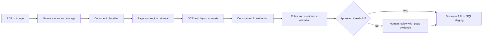

# AI Radar — 2026-11-27

## 🔥 Executive Summary

The centre of gravity has moved from single-model capability toward **governed agent execution**. Recent releases emphasize coding and computer-use agents, while their accompanying safety material makes the engineering implication plain: tool permissions, sandboxing, auditability, and evaluations are no longer optional production features.

Three signals matter most:

- OpenAI announced GPT-6.2 Astra and Sol on November 17, with a focus on professional work, coding, computer use, and lower-cost execution. [OpenAI announcement](https://openai.com/news/product-releases/)
- GitHub made several new agentic coding models available in Copilot and is consolidating cloud-based, resumable agent sessions across developer surfaces. [GitHub model update](https://github.blog/changelog/2026-11-17-openais-gpt-6-2-astra-and-gpt-6-2-sol-now-available/), [connected cloud experience](https://github.blog/changelog/2026-10-28-work-from-anywhere-with-a-new-connected-copilot-cloud-experience/)
- MCP maintainers are focusing on release predictability, portable server bundles, and file-transfer extensions. These are signs of an ecosystem moving from early integrations toward operational interoperability. [MCP blog](https://blog.modelcontextprotocol.io/)

## 🤖 AI Models & Generative AI

### GPT-6.2 Astra and Sol

**Company announcement, November 17.** OpenAI introduced GPT-6.2 Astra and Sol for ChatGPT Work, Codex, and the API, positioning them around professional output quality, coding, computer use, and efficiency. The important point for engineering teams is not a presumed benchmark win; it is that model selection is becoming workload-specific: a higher-capability option for long-horizon work and an efficient option for routine reasoning and execution. [Product update](https://openai.com/news/product-releases/)

**Maturity:** Production product release, subject to plan, region, and administrator availability.

**Practical implication:** Define routing policies by task class. For example, use a lower-cost model for document classification and extraction validation, then reserve a higher-capability agent for exception investigation or multi-repository refactoring.

### Claude Fable 5.2 and Mythos 5.2

**Company announcement, November 9.** Anthropic describes Claude Fable 5.2 and Mythos 5.2 as its most capable models for difficult technical work in coding, finance, and science. Treat vendor claims as a reason to evaluate on your own tasks, not as deployment evidence. The accompanying system-card publication is useful because it makes safety evaluation material part of the release surface. [Announcement](https://www.anthropic.com/news/models), [system cards](https://www.anthropic.com/system-cards)

## 🧠 Agents & Agentic AI

### Better autonomy raises the control-plane bar

OpenAI’s November research update reports that agents completed a larger share of internal research tasks than earlier in 2026, but performance varied substantially by task type. That variability is the central operational lesson: evaluate agents against the narrow workflows you intend to delegate, with realistic tools, permissions, and stopping conditions. [Research acceleration](https://openai.com/index/research-acceleration-jagged-frontier/)

Recommended production controls:

| Control | Why it matters |
| --- | --- |
| Scoped identities and short-lived credentials | Limits the action surface of tool-using agents |
| Isolated execution environments | Contains file, network, and dependency risk |
| Approval gates for external side effects | Keeps high-impact actions human-authorized |
| Trace capture | Makes tool calls, inputs, outputs, and decisions reviewable |
| Task-specific evaluation suites | Detects regressions hidden by generic benchmark scores |

## 🔍 RAG & Knowledge Systems

### Query-driven document extraction is a promising RAG pattern

**Research-stage.** AgenticOCR proposes extracting only the parts of a document needed for a query, rather than running a uniform full-document OCR pipeline first. The idea is attractive for long, visual, or expensive documents because it can route effort to candidate pages and regions. It remains research, so validate recall, latency, and citation quality on your own document corpus before treating it as a production architecture. [AgenticOCR paper](https://arxiv.org/abs/2602.24134)

For enterprise RAG, keep a durable source record even when using iterative retrieval: document ID, page, region, OCR version, extraction confidence, and retrieval query should travel with every answer.

## 👁️ Computer Vision / OCR / Multimodal

### Long-document visual QA needs iterative evidence gathering

**Research-stage.** MM-Doc-R1 explores multi-turn, vision-aware discovery over long documents rather than a single retrieval pass. This aligns with a practical document-intelligence design: fast candidate retrieval first, targeted image or layout analysis second, and validation against the original page before returning a field to a downstream system. [MM-Doc-R1 paper](https://arxiv.org/abs/2604.13579)

The architecture is especially relevant for invoices, engineering drawings, forms, and scanned technical manuals, where plain text extraction loses table layout, visual anchors, and spatial relationships.

## 💻 AI Coding & Software Engineering

### Model choice and agent supervision are becoming normal developer-platform work

**Product update, November 17.** GitHub added GPT-6.2 Astra and Sol to Copilot, and also announced MAI Code 2 and MAI Code 2 Flash. These releases reinforce a useful operating model: match models to work such as quick edits, repository-scale changes, deep debugging, or review; then measure outcomes in your codebase. [GPT-6.2 in Copilot](https://github.blog/changelog/2026-11-17-openais-gpt-6-2-astra-and-gpt-6-2-sol-now-available/), [MAI Code 2 update](https://github.blog/changelog/2026-11-17-mai-code-2-and-mai-code-2-flash-in-github-copilot/)

GitHub’s guidance on agentic engineering is a useful counterweight to demo-driven adoption: faster implementation shifts the bottleneck toward requirements, review, testing, production investigation, and ownership. [GitHub engineering guide](https://github.blog/ai-and-ml/github-copilot/beyond-code-generation-a-developers-guide-to-agentic-engineering/)

## 🔌 MCP & Tool Ecosystem

### MCP is maturing operationally, not just adding tools

**Community and protocol-maintainer updates.** The MCP project is establishing a more predictable release process, discussing file upload/download support, and adopting a portable `.mcpb` bundle format for local servers. These developments matter because enterprise adoption depends on packaging, versioning, authentication, and lifecycle management as much as on a tool schema. [Release-cycle update](https://blog.modelcontextprotocol.io/posts/mcp-release-cycle/), [MCP blog](https://blog.modelcontextprotocol.io/)

**Production guidance:** Treat every MCP server as a security boundary. Maintain an allowlist, use least-privilege tokens, log invocations, pin versions, and separate read-only from write-capable tools.

## 📚 Research Papers

| Paper | Status | Why read it |
| --- | --- | --- |
| [AgenticOCR](https://arxiv.org/abs/2602.24134) | Research-stage | A query-driven alternative to one-size-fits-all OCR pipelines |
| [MM-Doc-R1](https://arxiv.org/abs/2604.13579) | Research-stage | An agentic approach to visual question answering over long documents |

## 🛠️ Tools & GitHub Projects

- **GitHub Copilot cloud experience:** Resume cloud agent sessions across GitHub, mobile, IDE, CLI, Slack, and Teams. Evaluate its sandboxing, permission configuration, and shared Actions-compute accounting before broad rollout. [GitHub announcement](https://github.blog/changelog/2026-10-28-work-from-anywhere-with-a-new-connected-copilot-cloud-experience/)
- **MCP Bundle (`.mcpb`):** An ecosystem proposal for portable local MCP-server installation. Experimental; assess packaging provenance and update controls before enterprise use. [MCP blog](https://blog.modelcontextprotocol.io/)

## 🌎 Developer Community Trends

The developer conversation is moving from “which model is best?” to “which agent configuration is safe and economical for this workflow?” The strongest public signals are:

- More coding-model choices inside the same developer platform.
- Resumable cloud agent sessions with explicit permission policy.
- More attention to MCP server packaging, authentication, and recovery from expired sign-in sessions.
- A sharper focus on review queues and evaluation as code volume increases.

## 🔥 5 Things Worth Knowing

1. Agent adoption should begin with bounded workflows and measurable outcomes, not broad autonomy claims.
2. Tool access, credentials, and network controls now define much of an agent system’s production risk.
3. AI coding value shifts from typing code to improving the whole engineering loop: requirements, testing, review, and operations.
4. MCP is becoming an integration platform; package and govern servers like any other internal service.
5. Multimodal RAG should preserve page-level evidence and confidence rather than collapsing documents into untraceable text chunks.

## 🧪 Practical POC

### Evidence-backed document intake assistant

Build a service that receives an invoice, specification, or drawing; identifies the relevant page and region for a requested field; extracts it; and returns the value with a visual source reference and confidence score.

Start with one document type and 30-50 representative samples. Measure field-level accuracy, evidence-link correctness, latency, and human-review rate. Do not allow automatic writes to ERP or SQL Server until the confidence and validation rules are proven.

## 💡 Trending Real-World Problem

### Problem

Operations teams spend time re-keying high-value fields from mixed PDFs: purchase orders, certificates, drawings, and compliance documents. Traditional OCR returns text but frequently loses the table structure or visual context needed to trust a value.

### Why It Is Difficult

- Documents vary by vendor, language, layout, and scan quality.
- Critical fields can appear in tables, headers, diagrams, or handwritten annotations.
- A plausible wrong extraction is often more dangerous than an explicit failure.
- Access control and data retention requirements can rule out unmanaged external processing.

### Proposed Solution

Use a staged, evidence-first pipeline: classify the document, retrieve likely pages, perform targeted OCR/layout analysis, ask a multimodal model to extract a constrained schema, then validate business rules and present evidence for human review.

### Architecture



### .NET Example

```csharp
public sealed record ExtractedField(
    string Name,
    string Value,
    decimal Confidence,
    int Page,
    string EvidenceReference);

public static bool IsReadyForStaging(ExtractedField field) =>
    field.Confidence >= 0.95m &&
    !string.IsNullOrWhiteSpace(field.EvidenceReference) &&
    field.Page > 0;
```

Keep the extraction service behind an API boundary. Store the original document, normalized extraction, validation result, model/prompt version, and reviewer decision as an auditable record.

### Production Considerations

- Use a private network path and managed identity for storage, queues, and databases.
- Restrict the extractor to the minimum document set and tool permissions required.
- Version prompts, schemas, OCR engines, and validation rules.
- Add replayable evaluations before changing model or extraction logic.
- Measure false acceptance separately from overall accuracy.
- Keep human review for low-confidence, high-value, or policy-sensitive fields.

## Sources

- [OpenAI product releases](https://openai.com/news/product-releases/) — November 2026, company announcement
- [GPT-6.2 Astra and Sol in GitHub Copilot](https://github.blog/changelog/2026-11-17-openais-gpt-6-2-astra-and-gpt-6-2-sol-now-available/) — November 17, 2026, GitHub changelog
- [MAI Code 2 and MAI Code 2 Flash in GitHub Copilot](https://github.blog/changelog/2026-11-17-mai-code-2-and-mai-code-2-flash-in-github-copilot/) — November 17, 2026, GitHub changelog
- [GitHub Copilot connected cloud experience](https://github.blog/changelog/2026-10-28-work-from-anywhere-with-a-new-connected-copilot-cloud-experience/) — October 28, 2026, GitHub changelog
- [Research acceleration: the jagged frontier](https://openai.com/index/research-acceleration-jagged-frontier/) — November 18, 2026, OpenAI research publication
- [Model Context Protocol blog](https://blog.modelcontextprotocol.io/) — November 2026, protocol-maintainer updates
- [AgenticOCR](https://arxiv.org/abs/2602.24134) — February 2026, research paper
- [MM-Doc-R1](https://arxiv.org/abs/2604.13579) — April 2026, research paper
- [GitHub guide to agentic engineering](https://github.blog/ai-and-ml/github-copilot/beyond-code-generation-a-developers-guide-to-agentic-engineering/) — November 6, 2026, GitHub engineering blog
